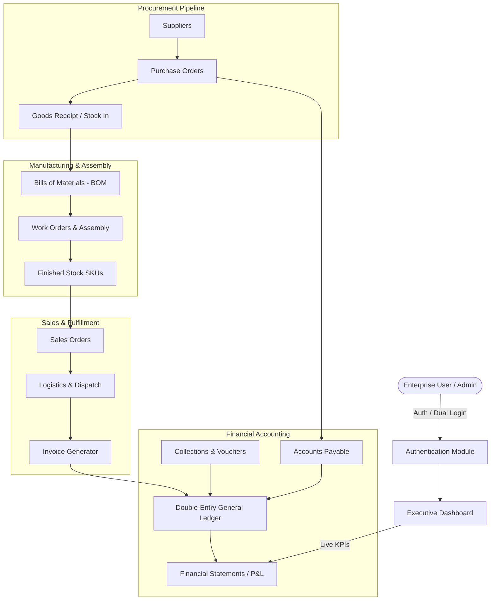

# TechImport Enterprise ERP Suite

> **Next-Generation Multi-Branch Enterprise Resource Planning & Supply Chain Platform**  
> **Lead Architect & Developer:** **Muhammad Danish**

[](https://www.djangoproject.com/)
[](https://www.python.org/)
[](https://getbootstrap.com/)
[](https://tailwindcss.com/)
[](https://www.postgresql.org/)
[](#)

---

## 📌 Executive Summary

**TechImport Enterprise ERP** is a modular, high-performance web enterprise resource planning suite engineered specifically for import houses, wholesale distributors, textile conglomerates, and manufacturing entities. It bridges the gap between fast-paced supply chain operations and financial ledger accuracy.

Engineered and designed by **Muhammad Danish**, the platform delivers real-time visibility into inventory across multi-branch warehouses, automates the procurement-to-payment and order-to-cash workflows, provides automated double-entry ledger bookkeeping, and delivers executive business intelligence with sub-second response times.

---

## 🏛️ System Architecture

TechImport ERP is built on a decoupled, domain-driven Django architecture. Each business function lives within its own isolated Django application while communicating seamlessly through standardized models, signals, and shared core utilities.

### 1. High-Level Architectural Flowchart

```
┌────────────────────────────────────────────────────────────────────────┐
│                        PRESENTATION LAYER (UI/UX)                      │
│   Django Templates (DTL) • Bootstrap 5.3 • Tailwind CSS (tw-*)         │
│   Chart.js • Tabulator/DataTables • Select2 • Flatpickr • SweetAlert2  │
│   Hover-to-Expand Sidebar • Split-Screen Dual-Section Auth Portal      │
└───────────────────────────────────┬────────────────────────────────────┘
                                    │ HTTP / REST / JSON
┌───────────────────────────────────▼────────────────────────────────────┐
│                  ROUTING & MIDDLEWARE LAYER                            │
│   Session Authentication • CSRF Verification • RBAC Authorization      │
│   CORS Headers • Global Context Processors (`erp_core`)                │
└───────────────────────────────────┬────────────────────────────────────┘
                                    │
┌───────────────────────────────────▼────────────────────────────────────┐
│                    BUSINESS DOMAIN LOGIC (14 APPS)                     │
│                                                                        │
│   ┌───────────────┐ ┌───────────────┐ ┌───────────────┐ ┌────────────┐ │
│   │   Dashboard   │ │    Sales      │ │   Purchases   │ │  Products  │ │
│   └───────────────┘ └───────────────┘ └───────────────┘ └────────────┘ │
│   ┌───────────────┐ ┌───────────────┐ ┌───────────────┐ ┌────────────┐ │
│   │   Inventory   │ │ Manufacturing │ │ Distribution  │ │  Invoices  │ │
│   └───────────────┘ └───────────────┘ └───────────────┘ └────────────┘ │
│   ┌───────────────┐ ┌───────────────┐ ┌───────────────┐ ┌────────────┐ │
│   │   Payments    │ │    Ledger     │ │    Reports    │ │ Roles/User │ │
│   └───────────────┘ └───────────────┘ └───────────────┘ └────────────┘ │
└───────────────────────────────────┬────────────────────────────────────┘
                                    │
┌───────────────────────────────────▼────────────────────────────────────┐
│                    DATA PERSISTENCE & ORM LAYER                        │
│   Django ORM • ACID Transactions • Aggregations & Query Optimization  │
│   PostgreSQL (Production) / SQLite (Development) • Redis Cache Ready   │
└────────────────────────────────────────────────────────────────────────┘
```

---

### 2. Domain Data Flow Diagram



---

## 📦 Core Domain Modules Breakdown

| # | Module | App Directory | Core Capabilities & Business Responsibilities |
|---|---|---|---|
| **1** | **Executive Dashboard** | `dashboard/` | Real-time KPI summary (Sales, Receivables, Payables, Stock Valuation), Chart.js visual analytics (Sales vs. Purchases, Cash Flow), Aging accounts overview, Live activity feed. |
| **2** | **Product & Catalog** | `products/` | Multi-category hierarchical SKU catalogue, barcode assignment, primary and secondary units (KG, PCS, BOX, MTR), supplier mapping, cost/sale price tiers, batch tracking. |
| **3** | **Sales Order Management** | `sales/` | Order capture, quotation-to-order pipeline, dynamic client credit limit validation, line-item tax calculations, order statuses (Draft, Confirmed, Dispatched, Invoiced). |
| **4** | **Purchases & Procurement**| `purchases/` | Vendor management, RFQ, Purchase Orders (PO), landed cost allocations, receiving notes, automated payable voucher triggers. |
| **5** | **Inventory & Warehouses** | `inventory/` | Multi-warehouse stock tracking, bin locations, stock movements (Transfer, Adjustment, Damage write-off), min-max reorder level alerts, valuation methods. |
| **6** | **Manufacturing & Assembly**| `manufacturing/`| Multi-level Bill of Materials (BOM), production staging, raw material reservations, labor/overhead costing, scrap tracking, assembly work orders. |
| **7** | **Logistics & Distribution**| `distribution/` | Consignment assignment, dispatch manifests, carrier tracking numbers, delivery confirmations, vehicle fleet allocation. |
| **8** | **Invoicing & Format Engine**| `invoices/` | Automated invoice generation from dispatches, custom Drag-and-Drop Invoice Format Builder, customizable tax heads, multi-currency layout. |
| **9** | **Payments & Reconciliations**| `payments/` | Customer collection receipts, vendor disbursements, partial payment allocations, bank/cash reconciliation vouchers. |
| **10**| **General & Client Ledger** | `ledger/` | Automated double-entry journals, chart of accounts, party-wise debit/credit ledgers, receivables aging buckets (0-30, 31-60, 61-90, 90+ days). |
| **11**| **Reports & Intelligence** | `reports_app/` | Sales breakdown, inventory valuation, Profit & Loss (P&L), Trial Balance, Balance Sheet, custom parameter report builder with CSV/PDF exports. |
| **12**| **Roles & Permissions (RBAC)**| `roles/` | Fine-grained permission matrix across 14 modules, role assignments (Admin, Finance Manager, Inventory Clerk, Sales Rep, Auditor). |
| **13**| **User Administration** | `users_app/` | User account provisioning, multi-branch assignment, status toggling, last activity tracking, security compliance. |
| **14**| **Authentication Portal** | `templates/auth/` | Two-column split-screen layout with enterprise branding showcase, interactive 1-click demo fill (`admin` / `admin123`), password reveal, session persistence. |

---

## 🎨 UI/UX Design System & Aesthetic Standard

The system follows an **enterprise design language** emphasizing clarity, density, and responsive micro-interactions:

* **Primary Palette**: Enterprise Royal Blue (`#1E5EFF`), Midnight Dark Navy (`#0B132B` / `#0D1F55`), Pure Surface (`#FFFFFF`), Soft Borders (`#E2E8F0`).
* **Hover-to-Expand Collapsible Sidebar**:
  * Default collapsed mini-state (`72px`) maximizes data density for grids and tables.
  * Hardware-accelerated hover expansion (`260px` in `250ms`) floats over content with elevated shadow (`box-shadow: 10px 0 36px rgba(5, 15, 45, 0.42)`).
  * Persistent pin/unpin state stored in browser `localStorage`.
* **Zero CSS-Tailwind Conflict**: Tailwind utilities strictly use the `tw-` prefix (e.g. `tw-sticky`, `tw-flex`, `tw-gap-4`), preventing conflicts with Bootstrap 5.3 components.
* **Component Kit**:
  * Toast system (`ERP.toast()`)
  * SweetAlert2 confirmation dialogs (`ERP.confirmDelete()`)
  * Select2 searchable select dropdowns with Bootstrap 5 skin
  * Flatpickr date range pickers
  * Chart.js canvas renderers with custom tooltips

---

## ⚙️ Technology Stack

```
Frontend:
├── Django Template Language (DTL) 6.x / 5.x
├── Bootstrap 5.3.3 (Modals, Offcanvas, Dropdowns, Grid)
├── Tailwind CSS (Prefixed: tw-*)
├── Vanilla JavaScript (ES6+ Modules, zero heavy framework bloat)
├── Chart.js 4.x (Financial Analytics & Trend Lines)
├── Bootstrap Icons 1.11.3 & FontAwesome
├── Select2 4.1 & Flatpickr
└── SweetAlert2 11.x

Backend & Core:
├── Python 3.14+
├── Django 6.0.8 / 5.2 (High-throughput WSGI/ASGI)
├── Django REST Framework 3.17.1 (JSON endpoints)
├── django-cors-headers
└── SQLite3 (Dev) / PostgreSQL + Redis (Production Ready)
```

---

## 🚀 Quick Start & Installation Guide

### 1. Prerequisites
* Python 3.10+ (Recommended: Python 3.12 or 3.14)
* Git installed
* Modern Web Browser (Chrome, Firefox, Safari, Edge)

### 2. Clone and Setup Environment

```bash
# Clone the repository
git clone https://github.com/muhammad-danish/techimport-erp.git
cd techimport-erp

# Create virtual environment (Windows Powershell)
python -m venv venv
.\venv\Scripts\Activate.ps1

# (Linux / macOS)
# python3 -m venv venv
# source venv/bin/activate
```

### 3. Install Dependencies

```bash
pip install -r requirements.txt
# Alternatively, install core requirements directly:
# pip install django djangorestframework django-cors-headers
```

### 4. Database Setup & Migrations

```bash
# Run schema migrations across all 14 apps
python manage.py makemigrations
python manage.py migrate
```

### 5. Seed Initial Base Data & Superuser

```bash
# Create or verify admin credentials
python manage.py shell -c "
from django.contrib.auth import get_user_model
User = get_user_model()
if not User.objects.filter(username='admin').exists():
    User.objects.create_superuser('admin', 'admin@techimport.com', 'admin123')
    print('Superuser created: admin / admin123')
else:
    print('Superuser admin already exists')
"
```

### 6. Run Development Server

```bash
python manage.py runserver 127.0.0.1:8000
```

Open your browser at: **[http://127.0.0.1:8000/](http://127.0.0.1:8000/)**

---

## 🔑 Default Credentials (Out-of-the-Box)

The login screen features an automated **One-Click Demo Fill** button for instant administrative access:

* **URL**: `http://127.0.0.1:8000/login/`
* **Username**: `admin`
* **Password**: `admin123`
* **Role**: System Administrator (Full Unrestricted Access)

---

## 📁 Project Directory Tree

```
d:/textile/
├── manage.py
├── db.sqlite3
├── README.md
├── erp_core/                 # Master configuration, settings & context processors
│   ├── settings.py
│   ├── urls.py
│   ├── wsgi.py
│   ├── asgi.py
│   └── context_processors.py # Global permissions, notifications, ERP metadata
│
├── dashboard/                # Executive dashboard & real-time analytics
│   ├── urls.py
│   ├── views.py
│   └── models.py
│
├── products/                 # Catalog, SKUs, Categories, Units
├── sales/                    # Sales orders, quotes, dispatching
├── purchases/                # POs, Supplier directory, receiving
├── inventory/                # Multi-warehouse stock, ledger movements
├── manufacturing/            # BOM formulas, work orders, scrap
├── distribution/             # Consignment dispatches & tracking
├── invoices/                 # Tax invoices & custom format builder
├── payments/                 # Receipts, vouchers, reconciliations
├── ledger/                   # Double-entry general & client ledgers
├── reports_app/              # P&L, balance sheets, custom exports
├── roles/                    # RBAC permissions matrix
├── users_app/                # Employee user accounts
│
├── static/                   # Compiled & static enterprise assets
│   ├── css/
│   │   └── main.css          # Design system variables, layout, animations
│   └── js/
│       └── main.js
│
└── templates/                # Server-rendered DTL templates
    ├── base.html             # Global shell layout
    ├── auth/
    │   └── login.html        # 2-section split-screen login page
    ├── partials/
    │   ├── navbar.html       # Topbar, notifications, user profile
    │   ├── sidebar.html      # Hover-to-expand multi-app sidebar
    │   └── quick_action_modal.html
    ├── dashboard/
    ├── products/
    ├── sales/
    ├── purchases/
    ├── inventory/
    ├── manufacturing/
    ├── distribution/
    ├── invoices/
    ├── payments/
    ├── ledger/
    ├── reports_app/
    ├── roles/
    └── users_app/
```

---

## ⌨️ Global Keyboard Shortcuts

| Shortcut | Action Description | Target Element |
|---|---|---|
| <kbd>/</kbd> | Instant global navigation search | Focuses `.navbar-search-input` |
| <kbd>N</kbd> or <kbd>n</kbd> | Quick Action / New Document modal | Triggers `#btn-new` |
| <kbd>Esc</kbd> | Dismiss active modal or overlay | Closes `.modal.show` |

---

## 🛡️ Security & Enterprise Best Practices

* **CSRF Protection**: All form submissions and asynchronous `fetch()` API calls pass valid Django CSRF tokens via `window.ERP.csrfToken`.
* **RBAC Enforcement**: Server-side permission guards at both view layer and template presentation layer (``).
* **SQL Injection Prevention**: 100% ORM parameterized querying; raw unescaped queries are strictly prohibited.
* **XSS Sanitization**: Template auto-escaping active across all dynamic content outputs.
* **Session Security**: 24-hour rolling session cookie timeout with security headers (`X-Frame-Options: DENY`, `X-Content-Type-Options: nosniff`).

---

## 👨‍💻 Author & Lead Architect

* **Developer & Architect**: **Muhammad Danish**
* **Project Role**: Senior Full-Stack Software Engineer & ERP Systems Designer
* **Specialization**: Enterprise Django Backends, High-Density UI/UX Design, Relational Database Optimization & Supply Chain Workflow Automation

---

## 📄 License & Intellectual Property

Copyright © 2026 **Muhammad Danish** • TechImport Enterprise ERP Suite.  
All Rights Reserved. Provided for enterprise commercial and deployment usage.
